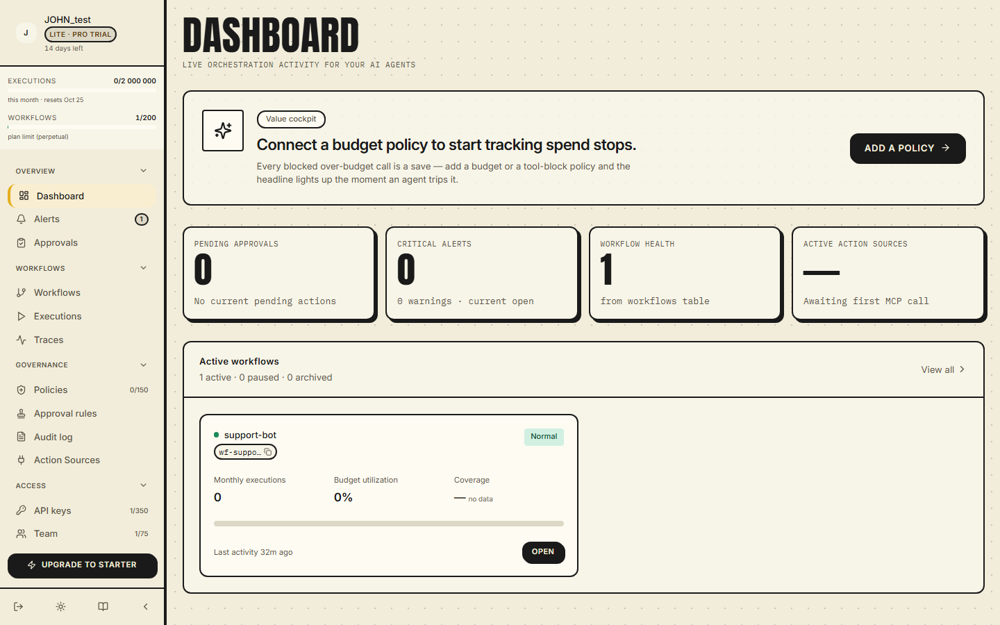
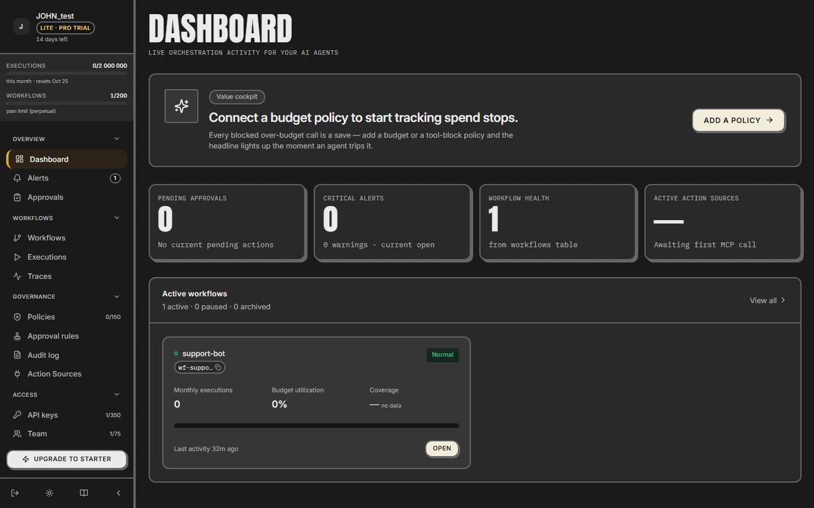
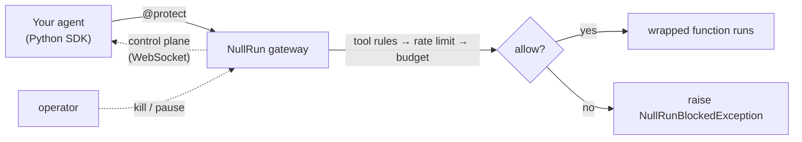
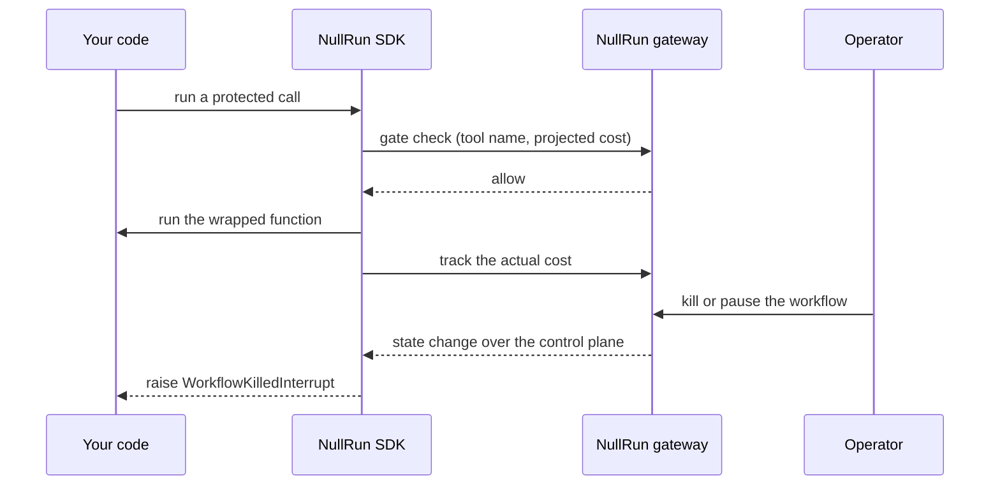

<!-- Brand hero — title, subtitle, install + protect code, CTA buttons.
     All hero/sections/feature classes live in extra.css
     (.nr-hero, .nr-section, .nr-features, .nr-feature, etc.).

     The hero leads with code, not with a screenshot. A reader who
     landed here from a search result or a link in an issue came for
     the integration, and the control center image was the only thing above
     the fold telling them what the product looks like rather than what
     it does. The control center shot moved to its own section below the
     fold, where it still runs but answers a question the code above
     it has already framed. -->
<section class="nr-hero md-grid md-typeset">
  <div>
    <h1 class="nr-hero__title">Runtime decision layer for tool-using AI agents</h1>
    <p class="nr-hero__subtitle">Before your agent executes a supported tool or model call, the SDK asks the gate.
      <code>allow</code>, <code>block</code>, or
      <code>require_approval</code> — backed by tool patterns, budgets, rate limits, and human approvals.
    </p>

    <div class="nr-hero__install"><code>pip install nullrun</code></div>

    <div class="nr-hero__code">

```python title="your_tool.py"
import nullrun

nullrun.init()


@nullrun.protect
def refund_customer(order_id: str, amount_cents: int) -> str:
    """The gate answers before this body runs."""
    return payments.refund(order_id, amount_cents)
```

    </div>

    <p class="nr-hero__codefoot">
      Decorate the tool. The gate evaluates the call; your function
      runs only if the decision is <code>allow</code> — and waits for a
      human if the policy says <code>require_approval</code>.
    </p>

    <!-- Three CTA levels, not one repeated. Primary is the docs'
         own next step; the FLAG plate is the external prerequisite a
         reader hits on the same screen; the tertiary is an in-docs
         read that is useful but not the thing they came to do. -->
    <div class="nr-hero__cta">
      <a class="primary" href="getting-started/quickstart/">Get started →</a>
      <a class="secondary" href="https://nullrun.io">Get an API key</a>
      <a class="tertiary" href="concepts/circuit-breaker/">How the gate works</a>
    </div>
  </div>
</section>

<section class="nr-section nr-section--shot md-grid md-typeset">
  <figure class="nr-shot">
    
    
    <figcaption class="nr-shot__caption">
      Every gate decision, budget reservation, and cost event lands in
      the control center. That is the whole surface an operator touches.
    </figcaption>
  </figure>
</section>

<section class="nr-section md-grid md-typeset" markdown="1">
## How it fits together


</section>

<!-- The feature grid below is flush-left, NOT nested by indentation.
     Under `markdown="1"` the whole subtree is re-parsed as Markdown,
     where any line indented 4+ spaces is an *indented code block* — so
     the grid's own nesting (4/6/8 spaces) escaped as literal text
     instead of rendering, and the cards showed up as a code block.
     The heading still needs `markdown="1"`, so the grid's HTML
     indentation is what gives way, not the section. Five levels of
     nesting cannot fit under the 4-space limit at any indent width. -->
<section class="nr-section md-grid md-typeset" markdown="1">
## What you get out of the box

<div class="nr-features">
<div class="nr-feature">
<div class="nr-feature__icon">
<svg xmlns="http://www.w3.org/2000/svg" viewBox="0 0 24 24" fill="none" stroke="currentColor" aria-hidden="true">
<circle cx="12" cy="12" r="10"/>
<polyline points="12 6 12 12 16 14"/>
</svg>
</div>
<div class="nr-feature__title">Budget gate</div>
<div class="nr-feature__body">
Set a cap in cents for one workflow or the whole org. The gateway
reserves the money before the call runs. Hard mode blocks the
overrun. Soft mode allows a bounded overrun inside an active chain.
</div>
</div>
<div class="nr-feature">
<div class="nr-feature__icon">
<svg xmlns="http://www.w3.org/2000/svg" viewBox="0 0 24 24" fill="none" stroke="currentColor" aria-hidden="true">
<path d="M20 13c0 5-3.5 7.5-7.66 8.95a1 1 0 0 1-.67-.01C7.5 20.5 4 18 4 13V6a1 1 0 0 1 1-1c2 0 4.5-1.2 6.24-2.72a1.17 1.17 0 0 1 1.52 0C14.51 3.81 17 5 19 5a1 1 0 0 1 1 1z"/>
<path d="m9 12 2 2 4-4"/>
</svg>
</div>
<div class="nr-feature__title">Action-bound approvals</div>
<div class="nr-feature__body">
Operator approves sensitive calls via typed predicates
(<code>money_amount</code> / <code>tool_parameters</code>).
Every approval is bound to the exact action payload via a
SHA-256 <code>action_digest</code> — the grant is refused
if the SDK then executes a different amount or
different arguments.
</div>
</div>
<div class="nr-feature">
<div class="nr-feature__icon">
<svg xmlns="http://www.w3.org/2000/svg" viewBox="0 0 24 24" fill="none" stroke="currentColor" aria-hidden="true">
<path d="M4.9 19.1C1 15.2 1 8.8 4.9 4.9"/>
<path d="M7.8 16.2c-2.3-2.3-2.3-6.1 0-8.5"/>
<circle cx="12" cy="12" r="2"/>
<path d="M16.2 7.8c2.3 2.3 2.3 6.1 0 8.5"/>
<path d="M19.1 4.9C23 8.8 23 15.1 19.1 19"/>
</svg>
</div>
<div class="nr-feature__title">Real-time kill / pause</div>
<div class="nr-feature__body">
A WebSocket control plane pushes <code>killed</code> /
<code>paused</code> to every connected SDK. <code>WorkflowKilledInterrupt</code>
reaches the top of the agent loop, not a swallowed
<code>except Exception</code>.
</div>
</div>
<div class="nr-feature">
<div class="nr-feature__icon">
<svg xmlns="http://www.w3.org/2000/svg" viewBox="0 0 24 24" fill="none" stroke="currentColor" aria-hidden="true">
<rect x="3" y="11" width="18" height="11" rx="2" ry="2"/>
<path d="M7 11V7a5 5 0 0 1 10 0v4"/>
</svg>
</div>
<div class="nr-feature__title">ToolBlock policy</div>
<div class="nr-feature__body">
Server-side glob patterns (<code>mcp://payments/refund*</code>,
<code>bash</code>, <code>db.drop</code>) list the tools that must
never run. <strong>Always Hard</strong>: it fails closed on a
transport error, whatever the budget's <code>enforcement_mode</code>.
</div>
</div>
<div class="nr-feature">
<div class="nr-feature__icon">
<svg xmlns="http://www.w3.org/2000/svg" viewBox="0 0 24 24" fill="none" stroke="currentColor" aria-hidden="true">
<path d="M12.22 2h-.44a2 2 0 0 0-2 2v.18a2 2 0 0 1-1 1.73l-.43.25a2 2 0 0 1-2 0l-.15-.08a2 2 0 0 0-2.73.73l-.22.38a2 2 0 0 0 .73 2.73l.15.1a2 2 0 0 1 1 1.72v.51a2 2 0 0 1-1 1.74l-.15.09a2 2 0 0 0-.73 2.73l.22.38a2 2 0 0 0 2.73.73l.15-.08a2 2 0 0 1 2 0l.43.25a2 2 0 0 1 1 1.73V20a2 2 0 0 0 2 2h.44a2 2 0 0 0 2-2v-.18a2 2 0 0 1 1-1.73l.43-.25a2 2 0 0 1 2 0l.15.08a2 2 0 0 0 2.73-.73l.22-.39a2 2 0 0 0-.73-2.73l-.15-.08a2 2 0 0 1-1-1.74v-.5a2 2 0 0 1 1-1.74l.15-.09a2 2 0 0 0 .73-2.73l-.22-.38a2 2 0 0 0-2.73-.73l-.15.08a2 2 0 0 1-2 0l-.43-.25a2 2 0 0 1-1-1.73V4a2 2 0 0 0-2-2z"/>
<circle cx="12" cy="12" r="3"/>
</svg>
</div>
<div class="nr-feature__title">Auto-instrumentation</div>
<div class="nr-feature__body">
<code>nullrun.init()</code> activates
auto-instrumentation for OpenAI, Anthropic, LangGraph,
OpenAI Agents, Mistral, Gemini, Cohere, Bedrock, LlamaIndex,
CrewAI, and AutoGen. Vendor SDKs are patched in place —
every LLM call goes through the gateway.
</div>
</div>
<div class="nr-feature">
<div class="nr-feature__icon">
<svg xmlns="http://www.w3.org/2000/svg" viewBox="0 0 24 24" fill="none" stroke="currentColor" aria-hidden="true">
<path d="M15 12h-5"/>
<path d="M15 8h-5"/>
<path d="M19 17V5a2 2 0 0 0-2-2H4"/>
<path d="M8 21h12a2 2 0 0 0 2-2v-1a1 1 0 0 0-1-1H11a1 1 0 0 0-1 1v1a2 2 0 1 1-4 0V5a2 2 0 1 0-4 0v2a1 1 0 0 0 1 1h3"/>
</svg>
</div>
<div class="nr-feature__title">Audit chain</div>
<div class="nr-feature__body">
Every gate decision (allow, block, require_approval) lands in an
append-only audit log with a tamper-evident hash chain. Recompute
the chain on demand from the audit-log verify endpoint. The log is
a plan feature — Lite and Starter do not carry it.
</div>
</div>
</div>
</section>

<section class="nr-section md-grid md-typeset" markdown="1">
## What one protected call looks like



*End-to-end: the gate evaluation, cost accounting, and the kill path.*

The Python SDK runs inside your own process and talks to the gateway over
HTTPS. The gate check, the budget reservation, and the cost event all travel
over that connection. Policies, workflows, approvals, and the operator
controls live in the control center — that is where your team configures what
the gate enforces.
</section>

<section class="nr-section md-grid md-typeset" markdown="1">
## Let LLM do all the heavy work

You already run a coding agent — Claude Code, GPT, or anything else that
edits your repo. Give it the prompt below and it installs NullRun, wraps the
call sites that matter, handles the refusals, and writes the test. It reads
the code before it changes it.

Copy the block, paste it into your agent, and answer what it asks.

```text title="Prompt for Claude Code, GPT, or any coding agent"
Set up NullRun in this repository.

NullRun is a runtime decision layer for tool-using AI agents. The Python SDK
asks the gateway before every protected call. The gateway answers allow,
block, or require_approval. The call runs only on allow.

Docs: https://docs.nullrun.io

Read these two pages before you change anything:
- https://docs.nullrun.io/getting-started/quickstart/
- https://docs.nullrun.io/reference/sdk-api/

Work through the steps below. Stop and ask me when a step is ambiguous.

1. INSTALL
   Add `nullrun` to pyproject.toml or requirements.txt. Use the plain
   package. Do not add vendor extras.
   Read the key from the NULLRUN_API_KEY environment variable. If it is
   unset, ask me for one. Never write the key into a file. Never commit it.

2. INITIALIZE
   Add `import nullrun` and one `nullrun.init()` call at the entry point
   of the application. Call init() once.

3. PROTECT THE CALL SITES
   Find every call with a side effect: model completions, payment or
   messaging HTTP calls, database writes, file deletion, shell commands.
   Wrap each one with `@nullrun.protect`. The decorator takes no arguments.
   Keep the function name, the signature, and the return value.
   Leave pure functions alone.
   On a framework (LangGraph, LangChain, CrewAI, AutoGen, OpenAI Agents,
   LlamaIndex), wrap the agent entry point instead of every node. Say which
   choice you made.

4. HANDLE THE REFUSALS
   Wrap the entry point in `with nullrun.guard():`. It writes one report
   to stderr — the user message as the headline, then the developer
   detail — and exits with code 1.
   Where the app has its own error handling, catch `nullrun.NullRunError`
   and show `nullrun.format_user_message(exc)` to the user.
   Never swallow a refusal. A swallowed refusal means the call ran without
   being authorized.
   Register `nullrun.on_error(...)` if the project has a logging or error
   reporting system.

5. VERIFY
   Run the project's test suite. Add one test that calls a protected
   function and asserts that a NullRun refusal raises `nullrun.NullRunError`.
   Do not weaken or delete an existing test to make the suite pass.

6. REPORT
   Give me, in this order:
   - the files you changed and why;
   - the call sites you protected and the ones you left alone;
   - the control center steps only I can do: the spend cap in cents, the tools
     that must never run, and the calls that need a human. Include the tool
     names you found, so I can write the patterns;
   - anything you could not verify.
```

The prompt covers the code. Three things stay with you, because they live in
the control center, not in the repo:

| You do this | Where |
|---|---|
| Set the spend cap | Control center → Policies → New policy → Budget |
| List the tools that must never run | Control center → Policies → New policy → Tool block |
| List the calls that need a human | Control center → Approval rules |
</section>
